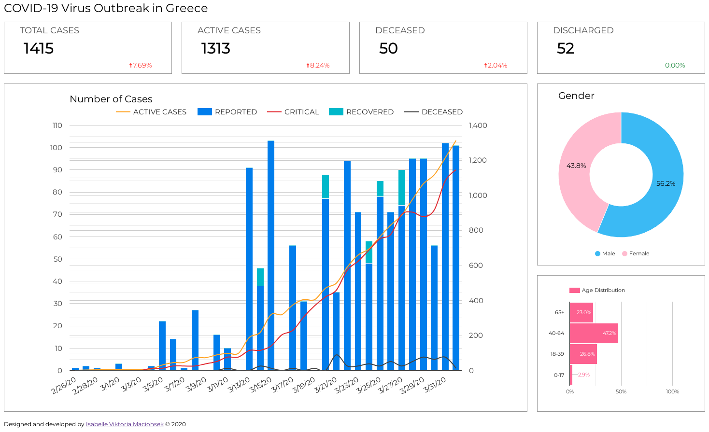

# COVID-19-Greece

[](https://trinityyi.github.io/COVID-19-Greece/)

A python-generated [website](https://trinityyi.github.io/COVID-19-Greece/) for visualizing the novel coronavirus (COVID-19) data for Greece.

## Data sources

Data provided by [Johns Hopkins CSSE](https://github.com/CSSEGISandData/COVID-19/tree/a4ccce6f44b175d304ad18fb88fe479bc76b2584) and the [National Public Health Organization](https://eody.gov.gr/en/).

## Website generation

- The website is updated daily at 03:00 UTC, using GitHub actions.
- Data is pulled daily from the relevant data sources and/or updated manually.
- The `src/main.py` script combines the data in the CSV files and generates the [daily CSV report](/time_series_data_grc.csv).
- [Flask](https://flask.palletsprojects.com/en/1.1.x/) then outputs the data and to the template and produces the [website](https://trinityyi.github.io/COVID-19-Greece/).
- [Google Charts](https://developers.google.com/chart/interactive/docs) is used for graph generation.

### Data rules

The sources are not always well behaved, so the pipeline applies these rules:

| Situation | Rule |
| --- | --- |
| A source has no value for a date | The merged cell is written empty (unknown). `-1` is never written as a count. |
| A cell is `-1`, empty, `N/A`, `unknown`, … | Treated as unknown; never used in arithmetic. |
| A column is unknown on a given day | The most recent known value is carried forward (last observation carried forward). If there is no known value yet, the value stays unknown. |
| Dates | Parsed as real calendar dates for sorting and joining, so `1/2/20` < `1/9/20` < `1/10/20` and `5/1/20` joins with `5/01/20`. |
| Dates far outside the primary series window (e.g. the `8/31/30` column typo) | Ignored with a warning on stderr. |
| A percentage change with a zero or unknown previous value | Rendered as the stable placeholder `0.00` instead of dividing by zero. |
| Summary cards | Each card uses the last row with a valid value for that metric; an entirely unknown metric renders as `—`. |
| Chart values | Unknown points render as `null`, which Google Charts draws as a gap rather than a cliff. |

Run the pipeline:

```bash
python3 src/main.py > docs/index.html                  # merge + render
python3 src/main.py --skip-merge --output-html docs/index.html   # render existing CSV
```

`src/main.py` accepts `--confirmed`, `--deceased`, `--recovered`, `--critical`,
`--output-csv`, `--data-csv`, `--output-html`, `--skip-merge`, `--no-print` for
local runs against alternative inputs.

### Tests and reproduction

The tests are self-contained: they use the hand-written CSVs under
`tests/fixtures` and need neither the JHU submodule nor network access.

```bash
python3 -m pytest tests -q
```

Covered failure modes:

1. **Source stopped publishing** — `tests/fixtures/deceased_global_stopped.csv`
   ends before the other sources. The merged row for the missing date carries an
   empty deceased cell, and the statistics carry the last known value forward.
2. **`-1` used for unknown** — `tests/fixtures/critical_unknown.csv` uses `-1`
   for critical cases. The merged CSV stores it as unknown, the statistics reuse
   the last known critical count, and the chart never sees `-1`.
3. **First day is all zeroes** — `tests/fixtures/all_zero_days.csv`. The cards
   and the day-over-day percentages render `0.00` without raising
   `ZeroDivisionError`.

To reproduce a single scenario by hand, point the CLI at the fixtures:

```bash
python3 src/main.py \
  --confirmed tests/fixtures/confirmed_global.csv \
  --deceased tests/fixtures/deceased_global_stopped.csv \
  --recovered tests/fixtures/recovered_global.csv \
  --critical tests/fixtures/critical_unknown.csv \
  --output-csv /tmp/merged.csv --output-html /tmp/index.html
```

Then inspect `/tmp/merged.csv` (empty cells for unknown dates) and
`/tmp/index.html` (cards at the end of `stat-wrapper`, chart rows near
`['DATE', 'ACTIVE CASES'`).
